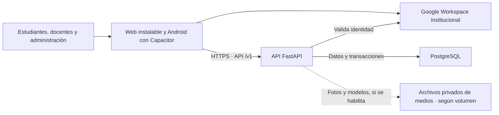

# Wallnut · Plan de desarrollo y arquitectura

**Proyecto de grado para dos personas · Universidad de Ibagué · Base de trabajo v0.7.0**

Wallnut conecta la participación en el campus con dos recorridos. En el académico, un estudiante asiste a un taller, acredita su participación y puede solicitar un ajuste de nota simulada con Ardi Points. En el de comunidad, descubre eventos, se inscribe y usa Ardi Coins para transferencias internas y personalización. El piloto debe permitir recorrer ambos flujos con cuentas verificadas, medir su adopción y reconstruir las operaciones desde su origen.

## 1. Punto de partida y alcance

| Estado | Alcance |
|---|---|
| Disponible en la demo local | Inicio de sesión por rol, convocatorias y talleres, asistencia por QR o código, evidencias, cupos docentes, Points y Coins, canje de nota simulada, tarjeta y pagos internos, eventos con cupos, ranking, editor 2D, tienda y nueces de tres toques. |
| Implementado con verificación institucional pendiente | Inicio de sesión con cuentas reales, instalación de la web en iPhone, Android conectado a un entorno HTTPS y escaneo entre dispositivos físicos. El APK actual de demostración abre la web local. |
| Propuesto para el piloto | Perfiles y publicaciones moderables, feed que reúna actividades, talleres y eventos, torneos con participantes y resultados, operación administrativa, y preparación del despliegue y la evaluación. |
| Ampliaciones con alcance por validar | Ardy 3D, reservas reales de espacios, premios de eventos institucionales, asistente conversacional y juegos donde se arriesguen Coins o prendas. El piloto incluye un asistente básico de ayuda si alcanza el cierre funcional. |

Las notas del piloto son ficticias. Los Coins tienen uso interno y carecen de valor monetario, depósitos, retiros y precios en moneda real. Las transacciones viven en el registro de Wallnut. La negociación entre estudiantes queda fuera del flujo de pago. La plataforma registra a quién se paga y cuántos Coins se transfieren mediante la tarjeta.

## 2. Arquitectura general

Se propone mantener la aplicación de Vue y TypeScript, el servidor FastAPI en Python y PostgreSQL. El mismo frontend se instala como web desde iPhone y se empaqueta en Android con Capacitor. La API se despliega como una sola aplicación con módulos por dominio. Las operaciones que afectan simultáneamente un cupo, una billetera, un premio o una nota usan una misma transacción de base de datos.

- **Interfaz**. Navegación y vistas por rol, componentes compartidos, accesibilidad y estados de carga, error, confirmación y recuperación. Cada sección administra su estado local y consulta la API tras una mutación.
- **API**. Los módulos actuales conservan sus rutas `/v1`. Los módulos nuevos exponen operaciones de negocio, devuelven errores consistentes y validan permisos sobre cada recurso. El cliente solo envía una intención. Precios, cupos, premios y permisos se calculan en el servidor.
- **Persistencia**. Migraciones SQL numeradas y versionadas. Identificadores UUID, fechas con zona horaria y cantidades enteras para Coins y Points. Las notas se manejan en milésimas y la agenda muestra la hora de Ibagué.
- **Archivos**. Las evidencias existentes permanecen privadas. El piloto puede conservar su almacenamiento actual. Para fotos sociales y modelos 3D se propone separar metadatos en PostgreSQL y archivos en almacenamiento de objetos cuando se justifique por tamaño o costo. Las reglas de acceso se aplican por tipo de archivo.
- **Operación**. Ambientes separados de desarrollo, demostración y piloto. Variables y credenciales por ambiente, migraciones verificadas, respaldos restaurables, registro de incidencias y despliegues reproducibles.

### Dependencias entre módulos

| Módulo | Usa información de | Recurso del que es responsable |
|---|---|---|
| Identidad y campus | Google Workspace | Cuentas, sesiones, roles, grupos y matrículas |
| Actividades académicas | Identidad y campus | Convocatorias, talleristas, agenda, asistencia y evidencias |
| Economía y canje | Identidad, talleres y evidencias | Cupos, políticas de recompensa, movimientos, reservas y nota simulada |
| Comunidad y torneos | Identidad y perfiles | Publicaciones, eventos, inscripciones y resultados |
| Ardy, tienda y nueces | Identidad y economía | Apariencia, catálogo, armario y progreso de apertura |
| Ranking | Participación verificada y visibilidad de Ardy | Consulta de clasificación y desempate |
| Asistente Ardi | Documentación y consultas publicadas en la API | Respuestas, fuentes y enlaces de navegación |

### Permisos del piloto

| Acción | Estudiante | Tallerista asignado | Docente asignado | Administración |
|---|---|---|---|---|
| Postularse e inscribirse en un taller | Sí, con su cuenta | Sí, como estudiante en otros talleres | Consulta su grupo | Consulta administrativa |
| Programar taller y emitir QR de asistencia | Según inscripción, usa el QR | Sí, en el taller asignado | Sí, en su taller | Consulta administrativa |
| Enviar evidencia o revisar la entrega | Envía la propia | Envía la propia como tallerista | Revisa las de su taller | Consulta de estado para soporte |
| Asignar cupo de Points | Consulta sus movimientos | Consulta sus movimientos | Consulta su cupo | Asigna cupo y consulta el historial |
| Gestionar un canje académico | Solicita con matrícula confirmada | Igual que estudiante | Configura y decide en su grupo | Consulta de estado para soporte |
| Enviar Coins, comprar y equipar artículos | Opera en su propia cuenta | Igual que estudiante | Consulta ayudas del flujo | Consulta auditoría para soporte |
| Publicar y cancelar eventos | Gestiona los propios | Gestiona los propios | Gestiona los propios | Publica y puede cancelar eventos |
| Moderar publicaciones | Denuncia contenido | Denuncia contenido | Denuncia contenido | Revisa y registra la decisión |

La matriz es el objetivo del piloto. El acceso de soporte se limita al estado y la referencia de la operación. Cada regla se prueba tanto desde la pantalla como con una petición directa a la API.

## 3. Arquitectura por sección

### 3.1 Inicio de sesión, carga y roles

- **Flujo**. Google institucional → intercambio por una sesión de Wallnut → verificación de sesión → inicio correspondiente. Estudiante abre Comunidad y accede a Mi Ardy y Billetera. Docente abre su espacio de talleres y grupos. Administración abre la gestión académica. El personal sin rol habilitado puede consultar las secciones permitidas.
- **Datos y autorización**. `accounts`, `sessions`, `course_sections` y `enrollments`. El correo institucional verificado habilita la cuenta estudiantil. Administración habilita el rol docente. Ser tallerista da permisos sobre el taller asignado, sin cambiar el rol global.
- **Desarrollo**. Verificar OAuth en el dominio de prueba, cierre y expiración de sesión, cambios de rol, restablecimiento de conectividad y acceso directo a enlaces que requieren sesión. Definir un método de revisión de cuentas inactivas para el piloto.
- **Aceptación**. Una cuenta personal es rechazada. Cada rol abre su vista y un estudiante recibe un error de permiso al invocar una operación docente aunque modifique la interfaz. Recargar conserva una sesión vigente.

### 3.2 Comunidad, perfiles y fotos

- **Flujo**. Un feed muestra tarjetas de convocatorias, eventos y publicaciones con filtros por tipo y procedencia. Cada tarjeta abre su sección de origen. Los estudiantes pueden publicar texto o una foto, editar o retirar lo propio y denunciar contenido.
- **Datos propuestos**. Configuración de visibilidad del perfil, `posts`, `post_media` y `content_reports`. El perfil muestra nombre, carrera si el estudiante elige publicarla y su Ardy. El feed es una consulta paginada por fecha e identificador sobre módulos existentes. Un evento conserva su estado en Eventos.
- **Permisos**. La comunidad autenticada ve las publicaciones activas. El autor controla las propias y administración puede ocultar contenido con motivo. El correo, la billetera, las notas y las evidencias académicas permanecen en sus secciones privadas.
- **Aceptación**. Un evento cancelado aparece con ese estado en el feed. Una imagen retirada deja de estar accesible desde su enlace social. Un perfil con carrera oculta queda oculto en todas las respuestas del feed.

### 3.3 Convocatorias, talleres y asistencia

- **Flujo**. Docente publica una convocatoria → estudiantes se postulan → docente selecciona un tallerista → se agenda el taller → asistentes reservan cupo → se verifica asistencia durante la actividad.
- **Datos**. `workshop_calls`, `facilitator_applications`, `workshops`, `workshop_enrollments` y `workshop_attendance`. El aforo se comprueba al inscribir, con bloqueo del taller para resolver solicitudes concurrentes. El QR y su código manual están ligados al taller y a una ventana de tiempo.
- **Desarrollo**. Agregar cancelación y mensajes de estado visibles para inscritos. Verificar escaneo en iPhone, Android y un segundo dispositivo. Mantener el ingreso manual al denegar cámara.
- **Aceptación**. Dos solicitudes por el último cupo producen una sola inscripción. Un QR vencido, usado en otro taller o presentado por alguien sin cupo es rechazado. Una asistencia válida queda registrada una vez.

### 3.4 Evidencias y verificación de metas

- **Flujo**. El asistente registrado o el tallerista sube foto y reflexión. El docente asignado aprueba o devuelve la entrega con comentario. Puede verificar por separado la meta que otorga Coins.
- **Datos**. `workshop_evidence` registra el vínculo con actividad y estudiante. La revisión referencia la versión de envío, para evitar aprobar una foto que fue reemplazada mientras estaba abierta. Se propone un historial de revisiones para el piloto.
- **Permisos**. El autor y el docente asignado consultan la foto. Antes de guardar, se verifica el formato y se normaliza la imagen. La foto del taller nunca se publica automáticamente en el feed.
- **Aceptación**. Una devolución permite corregir y reenviar. Un tercero recibe denegación al solicitar la foto. Repetir la aprobación o verificación conserva una sola recompensa por motivo.

### 3.5 Cupo docente, Ardi Points y notas simuladas

- **Flujo**. Administración asigna Points a un docente. El docente configura la recompensa del taller y las reglas del grupo. El estudiante matriculado solicita un ajuste. Se reservan los Points compatibles hasta que el docente aprueba o rechaza.
- **Datos**. `faculty_point_budgets`, `point_allocations`, `workshop_economies`, `wallet_movements` y tablas de canje y notas simuladas. Cada abono de Points tiene taller y grupo de origen. El canje reserva lotes compatibles y registra el efecto en la nota. Si se habilita editar reglas después de un canje, guardar versiones y vincular cada solicitud con la versión que se le aplicó.
- **Regla del piloto**. El docente selecciona equivalencia, tope por corte, mínimo opcional y grupos de origen admitidos. Hay que acordar si el umbral del piloto usa la nota base del corte o una medida adicional. El sistema actual trabaja con la nota base simulada. Si se conservan canjes de Coins a Points, deben seguir ligados a la meta verificada del estudiante y al cupo del docente.
- **Aceptación**. Un canje que supera el tope, el saldo elegible o la regla vigente falla sin descontar Points. Rechazar libera la reserva. Aprobar consume la reserva y actualiza la nota en la misma transacción. La equivalencia es visible antes de confirmar.

### 3.6 Ardi Coins, billetera y tarjeta virtual

- **Flujo**. Los Coins se obtienen inicialmente tras verificar metas. El estudiante consulta saldos y movimientos, cambia la apariencia de su tarjeta y solicita un pago por QR o código. Quien paga ve la cantidad y el destinatario antes de confirmar.
- **Datos actuales**. Los movimientos de talleres, pagos, compras y nueces guardan sus operaciones de origen. La billetera suma estas fuentes. Antes de agregar más emisores de Coins, se propone un único servicio que aplique los movimientos de todas las secciones con una clave de operación única.
- **Evolución**. Si crecen los tipos de operación, introducir un libro de Coins con transacción, entradas y referencia de origen. Una transferencia registra un débito y un crédito por la misma cantidad. Compras y premios registran contrapartidas internas de tienda y emisión. Migrar el histórico solo tras comprobar que saldo, fecha y referencia coinciden por cuenta. Registrar correcciones con movimientos inversos auditables.
- **Aceptación**. Una solicitud dura cinco minutos y se paga una vez. Un estudiante no se puede pagar a sí mismo. Dos gastos simultáneos no pueden consumir los mismos Coins. Repetir un envío por pérdida de conexión devuelve el resultado anterior. Los pagos de Coins no modifican los Points ni el ranking.

### 3.7 Mi Ardy, armario, tienda y nueces

- **Flujo**. Seleccionar carrera o estilo inicial → personalizar por partes → probar artículos del armario → guardar. La tienda ofrece compra directa y nueces. Después de pagar una nuez, tres toques producen grieta, separación y revelación. El progreso queda guardado en el servidor.
- **Datos**. `ardy_profiles` guarda aspecto y visibilidad. Las compras y nueces abiertas acreditan la tenencia de artículos. Para más colecciones, versionar catálogo, precio y probabilidades. Cada apertura referencia una colección y conserva su resultado. Un artículo equipado debe pertenecer al estudiante o ser gratuito.
- **Rarezas**. El precio inicial es 4 Coins. El catálogo actual contiene ocho prendas distintas y cuatro rarezas. Las probabilidades iniciales son 60 %, 25 %, 12 % y 3 %. Las probabilidades visibles reflejan las prendas que le quedan al estudiante. El servidor selecciona el premio al comprar y revela su identidad en el tercer toque.
- **Vista 3D**. Cargar la escena al elegir 3D y reutilizar los identificadores de apariencia del editor 2D. El primer modelo compone el cuerpo y los accesorios con geometría generada en Three.js. El editor abre en 2D y vuelve a esa vista si falla WebGL. Validar interacción y rendimiento en Android e iPhone antes de incorporar modelos glTF/GLB.
- **Aceptación**. Un reintento cobra una sola vez. Recargar tras el segundo toque permite continuar desde ahí. Solo al tercer toque se desbloquea la prenda. La pantalla funciona por toque y teclado y muestra el nombre de la rareza además del color.

### 3.8 Ranking de participación

- **Flujo y datos**. Una consulta agrega Points acreditados por evidencias aprobadas entre estudiantes que aceptaron aparecer. El desempate se hace por actividades verificadas y los empates exactos comparten posición. Se leen `workshop_evidence`, `wallet_movements` y `ardy_profiles`.
- **Desarrollo**. Mantener el ranking actual en el piloto. Añadir filtros por período o programa solo después de definir cómo se confirma la carrera y cuántas personas conforman cada grupo. Usar clasificaciones separadas para torneos.
- **Aceptación**. Ocultar el perfil lo retira de la clasificación. Una compra, transferencia, nuez o ajuste de nota no cambia la puntuación. Nuevas evidencias aprobadas aparecen sin editar manualmente la tabla.

### 3.9 Eventos, espacios y torneos

- **Flujo**. Un estudiante o miembro autorizado del personal crea un evento con identidad del organizador, tipo, lugar, hora y cupos. Los asistentes se inscriben. El organizador o administración puede cancelar. Para torneos, se cierra inscripción, se publica el cuadro, se registran resultados y se determina la clasificación.
- **Datos**. `campus_events` y `campus_event_enrollments` son la base. Agregar `tournaments`, `tournament_entries`, `tournament_matches` y confirmación de resultados. Primera versión propuesta con eliminación directa, inscripción individual o por pareja y resultado confirmado por el organizador. Los equipos grandes y torneos por grupos pueden llegar después.
- **Espacios y recompensas**. Mostrar lugar informado en el piloto y confirmar disponibilidad por el canal que ya use la Universidad. Si se habilitan reservas, agregar inventario de espacios, responsable y control de solapamiento. Los eventos premiados por la institución necesitan un cupo propio y verificación de participación, con la misma trazabilidad que los talleres.
- **Aceptación**. Estudiantes distinguen eventos estudiantiles de institucionales e identifican cupos y hora. Solo quien organiza registra resultados. Un resultado confirmado avanza al participante correcto una vez. Un evento cancelado cierra inscripciones y sigue visible con el estado correspondiente.

### 3.10 Asistente Ardi y juegos

- **Asistente**. Primera versión en español con ayuda sobre acceso, inscripción, QR, recompensas y canjes. Tomar respuestas de una base de conocimiento versionada y enlazar la pantalla correspondiente. Si después se añade un modelo conversacional, probarlo con preguntas frecuentes y limitarlo a consultas autorizadas. Su aceptación requiere que identifique qué puede explicar y que derive al área adecuada cuando falta información.
- **Juegos de azar**. Propuesta para el alcance posterior del piloto. Primero, probar una moneda virtual de demostración sin afectar la billetera. Las apuestas con Coins o prendas requieren acordar con la Universidad el alcance, los límites y el tratamiento de disputas. Si se habilitan, usar sesiones de juego con reglas versionadas, resultado calculado en el servidor y liquidación única registrada. Mantener los Points académicos fuera de los juegos.

## 4. Secuencia de trabajo para dos personas

**Estimación inicial de 12 semanas desde v0.7.0**, ajustable tras acordar horas disponibles, alcance del torneo y fecha de entrega. Cada etapa termina con una demo reproducible.

| Semanas | Entrega | Persona A · experiencia y pruebas de uso | Persona B · API y datos |
|---|---|---|---|
| 1–2 | Entorno de pruebas y acceso por rol | Navegación por rol, estados de sesión, instalación y prueba en dispositivos | Ambiente HTTPS, OAuth de prueba, credenciales por ambiente, restauración inicial |
| 3–4 | Flujo académico verificable | Asistencia, evidencias y claridad de reglas en Billetera y Mis grupos | Casos de concurrencia y reintento, auditoría de cupos y notas simuladas |
| 5–6 | Feed y perfiles | Publicación, perfil, fotos y revisión del feed en móvil | Fuentes del feed, visibilidad, medios y moderación |
| 7–8 | Eventos y primer torneo | Inscripción individual o por pareja, cuadro y resultados | Capacidad, estados, avance de rondas y cancelación |
| 9–10 | Economía, Ardy y ayuda | Kit de pruebas de tarjeta y nueces, ayuda de Ardi y, si cabe, prototipo 3D | Servicio de operaciones de Coins, validación de armario, datos de ayuda y reconciliación |
| 11–12 | Piloto y entrega académica | Guías, pruebas con participantes y demostración final | Migraciones, respaldo y restauración, incidencias, exportes agregados y documentación |

Ambas personas revisan los cambios que toquen permisos, saldos o notas. Al cierre de la semana ocho se decide qué ampliaciones entran según lo observado. El plan reserva el cierre para pruebas y correcciones del recorrido completo.

## 5. Pruebas, operación y entrega de grado

- **Integración**. Ejecutar las pruebas existentes y agregar casos por módulo según sus criterios de aceptación. Probar OAuth, permisos sobre recursos, pagos concurrentes, balances, recompensas, apertura de nueces y migraciones desde una base de la versión anterior.
- **Recorridos en dispositivos**. Instalar la web en iPhone y probar Android con la versión del piloto. Probar cámara QR entre dos equipos, variante por código, pérdida de red, recarga, sesión vencida, pantalla pequeña y controles por teclado.
- **Operación y datos**. Acordar quién administra roles y contenido, los plazos de retención de fotos y respaldos, y la respuesta a incidentes. Registrar cambios de rol, ajustes, canjes y moderación con actor, fecha, acción y referencia. Excluir tokens, fotos y notas de los registros operativos.
- **Evaluación**. Medir inscripción → asistencia → evidencia → aprobación, uso de billetera y armario, inscripciones a eventos y errores de los recorridos clave. Usar resultados agregados por semana y una encuesta breve de usabilidad. Fijar metas y tamaño de muestra con el tutor antes de recoger datos.
- **Entregables**. Repositorio y migraciones reproducibles, arquitectura y decisiones, matriz requisito–prueba, guía por rol, versión web instalable de prueba, APK y manual para el entorno de prueba, informe de resultados y demo con datos ficticios.

## 6. Decisiones con la Universidad y el tutor

| Decisión | Propuesta de partida | Cuándo hace falta |
|---|---|---|
| Identidad, dominio y responsable del piloto | Cuenta institucional verificada, aprobación administrativa de docentes y ambiente propio | Semanas 1–2 |
| Elegibilidad del canje | Nota base del corte como mínimo opcional, equivalencia y límite definidos por el docente. Fijar los valores del experimento de grado con el tutor | Antes de probar el canje |
| Conversión de Coins a Points | Mantener el canje ligado a una meta verificada. Validar si los Coins recibidos de otra persona pueden financiarlo o si se exige procedencia académica individual | Antes de habilitar transferencias y canjes en cuentas reales |
| Roles y contenido público en el campus | Carrera y ranking voluntarios, fotos sociales con controles de visibilidad y responsable de moderación | Antes de habilitar perfiles y publicaciones |
| Lugares y eventos premiados | Lugar informado con confirmación externa. Cupo institucional específico si se habilitan recompensas | Antes de probar torneos o premios oficiales |
| Azar, 3D y asistente | Cajas cosméticas con probabilidades visibles. Prototipo 3D y ayuda consultiva acotados. Evaluación por separado de apuestas con saldo o prendas | Revisión de alcance en la semana 8 |

El primer incremento del plan es dejar listas **las cuentas institucionales de prueba, la instalación móvil y el recorrido completo de un taller**, desde la convocatoria hasta el canje simulado. A partir de ese entorno se incorporan el feed social y los torneos con las mismas cuentas y reglas.
