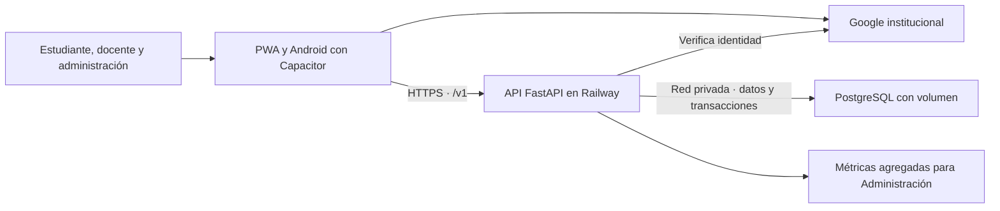

# Wallnut · Plan de desarrollo y arquitectura

**Actualizado el 18 de noviembre de 2026 · Proyecto de grado de dos personas · Universidad de Ibagué**

## 1. Objetivo y punto de partida

Wallnut busca que los estudiantes encuentren actividades del campus, ofrezcan o reciban apoyo académico y participen en eventos organizados por la comunidad. El piloto debe demostrar dos recorridos completos. En el académico, un docente usa su cupo de Ardi Points para reconocer participación verificada y el estudiante matriculado puede solicitar un canje con una nota simulada. En Comunidad, un estudiante descubre o crea una actividad, se inscribe, usa la billetera de Ardi Coins y personaliza su ardilla.

La plataforma se entrega como web instalable y comparte interfaz con Android mediante Capacitor. En iPhone el recorrido del piloto es abrir la web con Safari y agregarla a la pantalla de inicio. La identidad visual mantiene el azul y blanco, la ardilla personalizable y los símbolos propios de Ardi Points y Ardi Coins.

| Referencia | Estado comprobado |
| --- | --- |
| Código | La rama `main` de [Wallnut](https://github.com/Sekkon0906/wallnut) es la base activa. El [prototipo Flutter](https://github.com/Sekkon0906/wallnut/tree/archivo/prototipo-flutter) queda como referencia histórica. |
| Entregables móviles | La [versión 0.22.0](https://github.com/Sekkon0906/wallnut/releases/tag/v0.22.0) incluye un ZIP y un APK de demostración. Ese APK abre el entorno local. |
| Despliegue | La [web de Railway](https://wallnut-production.up.railway.app) sirve la API y los recursos de la PWA por HTTPS. La revisión vigente se registra en Railway. PostgreSQL tiene volumen persistente y acceso por red privada. `/v1/ready` devuelve HTTP 200 con el esquema listo. |
| Inicio de sesión institucional | La API valida tokens de Google y las funciones por rol están implementadas. En Railway el inicio sigue cerrado y responde HTTP 503 hasta configurar el cliente OAuth web. Hacen falta cuentas institucionales para aceptar el piloto. |
| Verificación | 63 pruebas de API, nueve de transporte y conexión y comprobación de tipos de la web. GitHub Actions ejecuta ambos grupos de pruebas y comprueba compilación, arranque y restauración de PostgreSQL en un entorno de prueba. La prueba con dispositivos físicos sigue pendiente. |

## 2. Estado por sección

| Sección | Qué hay | Qué falta para cerrar el piloto |
| --- | --- | --- |
| **Inicio, carga y roles** | Portada, Google institucional, recuperación y cierre de sesión y vistas por rol. Un aviso común permite comprobar la conexión y conserva la pantalla durante una interrupción, con un único intento por solicitud. Tallerista es un permiso sobre una actividad asignada. | Autorizar el origen de Railway en Google, habilitar la primera cuenta administradora y probar permisos, expiración, recarga, cambio de red y cierre con identidades reales. |
| **Comunidad y perfiles** | Feed cronológico con eventos, convocatorias y publicaciones, filtros por procedencia, paginación y apertura del recurso concreto. Hay perfiles voluntarios, fotos, edición, retirada, denuncias y moderación. | Acordar quién modera durante el piloto y verificar la experiencia con cuentas institucionales y dispositivos físicos. |
| **Convocatorias y talleres** | El docente publica, el estudiante sustenta su postulación y el docente selecciona al tallerista. Agenda con aforo, inscripción, reprogramación y cancelación con motivo. El docente asignado ve su lista privada y el estado de asistencia y evidencias. | Ensayo de extremo a extremo con dos equipos, revisión de avisos de cambios de horario y prueba de roles y concurrencia en el entorno institucional. |
| **Avisos** | Centro privado con contador y filtro sin leer. Los cambios de agenda llegan a los participantes actuales; las entregas, solicitudes y decisiones académicas llegan al docente o estudiante correspondiente. Cada aviso abre su taller o canje. | Probar los avisos nuevos con cuentas institucionales y confirmar que los usuarios encuentran el recurso y distinguen lo pendiente de lo leído. |
| **Asistencia y evidencias** | QR y código temporal vinculados al taller. Foto y reflexión privadas, devolución con comentario y reenvío. El docente asignado revisa la versión entregada y puede acreditar la recompensa o verificar una meta de Coins. | Probar cámara denegada, QR vencido, enlace directo de una foto, fallo de red durante la carga y recuperación. Acordar retención de fotos y evaluar si hace falta historial de todas las revisiones. |
| **Ardi Points y notas simuladas** | Administración asigna cupos y puede consultar su historial. Cada docente revisa sus asignaciones, acreditaciones y saldo. Configura equivalencia, tope, mínimo opcional y procedencias admitidas para el canje. La API reserva los Points hasta la decisión docente. | Acordar si el piloto usa nota base del corte, promedio ponderado o ambos. Definir límites y procedencia de Points en el escenario que se evaluará. Documentar los casos de aceptación acordados. |
| **Ardi Coins, billetera y tarjeta** | Historial completo con filtros por unidad, referencias, ingresos, gastos, reservas y comprobación del saldo. Tarjeta personalizable, pago por QR o código y recuperación de cobros y pagos interrumpidos. Prendas, nueces y conversiones comparten saldo. | Hacer la prueba de pago entre dos equipos físicos. Acordar la elegibilidad de Coins recibidos por transferencia para la conversión académica y verificar la regla elegida. Comprobar el resumen durante el recorrido institucional antes de ampliar la emisión. |
| **Ardy, armario y nueces** | Carrera editable y estilos iniciales por área. Editor de altura, complexión, pelaje, textura, cola, ropa y accesorios en 2D y 3D. Armario con prendas gratis, compras y nueces. La compra fija el premio y el tercer toque revela la prenda. Hay cuatro rarezas con brillo y probabilidades visibles. | Probar giro, carga, consumo y recuperación de 2D en dispositivos físicos. Verificar guardar una prenda obtenida tras cerrar y retomar una nuez. Ampliar estilos y accesorios después de medir el uso. |
| **Ranking** | Clasificación voluntaria por participación verificada. Usa puntos de evidencias aprobadas y desempate por actividades. Compras, transferencias y canjes de nota quedan fuera del cálculo. | Probar el retiro del ranking con dos cuentas reales. Acordar si conviene filtrar por periodo o programa y cómo se confirmaría la carrera. |
| **Eventos y torneos** | Eventos estudiantiles e institucionales, lugares, fechas, cupos e inscripción. Torneos de eliminación directa individuales y por parejas con invitaciones, cuadro, marcador y campeón. | Ejecutar un torneo piloto, confirmar el espacio por el canal de la Universidad y comprobar permisos del organizador. Las reservas formales y recompensas de eventos quedan como ampliaciones. |
| **Ayuda de Ardi** | Respuestas en español sobre tareas frecuentes y enlaces según el rol. El contenido está versionado con la aplicación. | Probar preguntas reales de los participantes, registrar dudas sin respuesta y ajustar el contenido. Evaluar alcance conversacional según el uso observado. |
| **Evaluación y operación** | Informe agregado semanal y CSV para Administración. Guías por rol, matriz requisito–prueba y protocolo con fichas de observación, preguntas e incidencias. Hay documentación de Railway y ensayo de restauración local. | Revisar las preguntas propuestas, acordar muestra y metas con el tutor, verificar respaldo y recuperación de Railway y completar los resultados del ensayo con usuarios. |

Ardi Points y Ardi Coins son unidades digitales internas sin valor monetario. Los Points conservan origen académico y salen del cupo autorizado. Los Coins se usan para pagos internos y cosméticos. El piloto usa calificaciones simuladas. Cualquier acuerdo entre estudiantes sobre un intercambio ocurre por fuera del pago registrado en Wallnut.

## 3. Arquitectura y límites entre secciones

- **Interfaz y contratos.** Vue y TypeScript. `web/src/client.ts` centraliza los contratos de API. `transport.ts` conserva autenticación, tiempos de espera, privacidad de caché y un único intento por solicitud. `connectivity.ts` ordena las observaciones para descartar resultados antiguos y `ConnectionStatus.vue` permite comprobar la recuperación sin recargar la vista. Las pantallas usan los permisos que devuelve el servidor y conservan estados de carga, confirmación y error.
- **Identidad y campus.** `identity.py` gestiona cuentas y sesiones. `campus.py` y Administración resuelven roles, grupos y matrículas. El recurso y su actor se validan en la API. Una propuesta para tallerista solo otorga facultades en el taller que le asignaron.
- **Talleres y evidencias.** `community.py`, `workshops.py`, `workshop_agenda.py` y `evidence.py` cubren convocatoria, agenda, asistencia, entregas y revisión. Las operaciones de aforo y revisión se verifican con solicitudes simultáneas. Las fotos académicas y sociales se guardan en PostgreSQL con reglas de acceso distintas. Revisar almacenamiento de objetos según el tamaño, la retención y el costo observados.
- **Economía y calificaciones.** `economy.py`, `grades.py`, `coin_payments.py`, `coin_shop.py` y `ardy_nuts.py` calculan elegibilidad, saldo, cupo y precio en el servidor. `wallet_history.py` usa las mismas fuentes que la billetera para consultar movimientos por unidad y referencia y contrastarlos con saldos y reservas. `faculty_ledger.py` reúne las asignaciones y acreditaciones del cupo docente. Las consultas usan una versión consistente de los datos. Las cantidades son enteras y las notas usan milésimas. Al agregar otra fuente de Coins, actualizar su cálculo y la comprobación del historial. Un libro de movimientos común tiene sentido cuando las fuentes actuales dificulten esa verificación.
- **Comunidad y torneos.** `social.py`, `profiles.py`, `events.py`, `tournaments.py` y `pairing.py` conservan el estado de sus propios recursos. `feed.py` reúne sus tarjetas por fecha, identificador y tipo, con paginación que conserva la posición. Cada tarjeta enlaza al recurso de origen y respeta el permiso vigente.
- **Avisos.** `notifications.py` conserva los avisos por destinatario y evento, con una referencia única para evitar duplicados. Agenda, evidencias y canjes los escriben dentro de su propia transacción. Las consultas y marcas de lectura se limitan a la cuenta autenticada. El cliente consulta el contador mientras está visible y abre cada recurso con sus permisos vigentes.
- **Ardy, ranking y ayuda.** El editor 3D carga bajo demanda la geometría y usa el mismo perfil que el lienzo 2D. El servidor valida los artículos equipados contra el armario. `ardy.py` calcula el ranking y `ardi_help.py` responde preguntas con contenido y enlaces por rol.
- **Operación.** El arranque valida configuración y aplica las 20 migraciones de forma transaccional. Railway comprueba `/v1/ready`. `pilot_metrics.py` entrega cifras agregadas y las fechas semanales usan hora de Colombia. Desarrollo y pruebas usan bases dedicadas. Las evidencias y credenciales se mantienen en sus entornos autorizados. [Guía de despliegue](despliegue-del-piloto.md)

## 4. Ruta de trabajo desde el estado actual

Las etapas se ordenan por dependencia. Las fechas se fijan cuando se conozcan la disponibilidad de los dos integrantes, el calendario de la Universidad y la fecha de entrega.

| Etapa | Trabajo verificable | Entrega y condición de cierre |
| --- | --- | --- |
| **1. Activar el piloto** | Crear el cliente OAuth web de Google. Registrar el origen de Railway. Configurar ID en web y API y retirar el modo temporal. La cuenta de personal acordada entra y se habilita como primera administración. Preparar un grupo y cuentas de cada rol. | Inicio, recarga y cierre probados. La cuenta personal y las operaciones de otro rol se rechazan. El despliegue HTTPS pasa la comprobación de esquema. |
| **2. Cumplir el recorrido académico** | Desde la convocatoria, seleccionar un tallerista, inscribir a dos estudiantes, emitir QR y registrar también por código. Entregar fotos y textos, devolver una evidencia y aprobar su corrección. Hacer un canje de nota simulada aprobado y otro rechazado. Probar reprogramación y cancelación con inscritos. | El docente reconstruye quién asistió, qué evidencia aprobó y qué cupo financió el abono. La billetera y la nota coinciden con el historial. Una solicitud repetida mantiene un único efecto. Regla de elegibilidad y procedencia acordada con el tutor. |
| **3. Completar Comunidad y experiencia móvil** | Validar el feed cronológico con filtros, moderación, borrado y fotos privadas. Probar PWA en Safari de iPhone y preparar Android con el cliente OAuth Android y la huella del certificado de prueba. Revisar QR, cambio de red, pago por tarjeta, nuez interrumpida y modo 3D. | Feed en móvil y escritorio con navegación a cada recurso. Un pago válido aparece en ambas billeteras. La apertura se reanuda en el toque correcto. Android y PWA se validan con cuentas de prueba en teléfonos físicos. |
| **4. Ejecutar el piloto y entregar el informe** | Confirmar lugar y responsable de un taller y un torneo de prueba. Registrar el cuadro y resultado. Tomar medidas por semana, aplicar encuesta breve, resolver incidencias y verificar una restauración en un entorno separado. | Matriz de aceptación con resultados observados, informe agregado, guías por rol, versión con APK de prueba, acta de resultados y demo reproducible. |

Mientras se obtiene OAuth, la revisión móvil con cuentas de demostración puede avanzar en paralelo. El feed ya está implementado y se verifica junto a sus recursos de origen. GitHub Actions ejecuta la suite de Python con PostgreSQL, las pruebas de conexión de la interfaz y el arranque y la restauración en tres trabajos separados del mismo flujo.

### Regresiones que cubre la aceptación

| Recorrido | Casos por comprobar |
| --- | --- |
| Identidad y permisos | Cuenta externa, sesión vencida, correo no verificado, docente sin grupo asignado y acceso directo a una foto restringida. |
| Aforo y asistencia | Dos solicitudes por el último cupo, QR de otro taller, QR vencido, registro repetido y alternativa manual sin cámara. |
| Recompensa y nota | Solicitud repetida, topes, origen incompatible, saldo insuficiente, cálculo del mínimo y reserva devuelta al rechazar. |
| Coins y cosméticos | Dos gastos simultáneos, confirmación de destinatario e importe, reintento desde otra conexión, recarga tras el segundo toque y prenda acreditada una sola vez. |
| Comunidad y torneo | Post retirado y foto denunciada, perfil privado, cancelación visible, aceptación de pareja, cierre de inscripción y avance de la pareja ganadora. |
| Operación | Instalación PWA, APK institucional, restauración de prueba, verificación de esquema y exportación CSV con acceso administrativo. |

Registrar por cada prueba la versión, el dispositivo, el rol, el resultado observado y la incidencia o evidencia de soporte. Mantener el [registro de verificación](verificacion-del-plan.md) al día.

## 5. Decisiones que faltan con los responsables

| Tema | Decisión necesaria |
| --- | --- |
| **Identidad y operación** | Quién es titular del cliente OAuth, quién administra el primer grupo y quién se hace cargo de la cuenta de Railway, la moderación y los respaldos. |
| **Mínimo académico** | Definir la medida de elegibilidad, su operador de comparación y el umbral del piloto. La implementación actual acepta una nota base simulada igual o superior al mínimo opcional del docente. Acordar equivalencia, tope y notas que se usarán en el ensayo. |
| **Procedencia del canje** | Decidir si se aceptan Points de otras materias y si el saldo de Coins recibido por transferencias puede financiar una conversión. El informe del piloto debe poder explicar la procedencia y el cupo utilizado. |
| **Privacidad y moderación** | Fijar quién atiende denuncias, visibilidad de carrera y ranking, retención de fotos y uso de evidencia para el informe. Preparar cuentas y datos ficticios para la demo pública. |
| **Tamaño y resultados del piloto** | Acordar con el tutor qué grupos, cuántos participantes, qué periodo y cómo se medirá el éxito. Designar quién consolida los resultados y las incidencias. |
| **Espacios y premios** | Confirmar el responsable del espacio y reglas del torneo. Una reserva de espacios con inventario y horarios o un premio institucional con cupo propio requiere definir su operación antes de desarrollar ese flujo. |

### Ampliaciones después del piloto

- Nuevas colecciones de nueces, más personalización y estilos por carrera según los datos de uso. Probar modelos 3D adicionales cuando los teléfonos del piloto soporten el editor actual.
- Clasificaciones por periodo o programa y más formatos de torneo. Definir el origen de los datos de carrera y la modalidad de equipos.
- Reservas de espacios, premios institucionales y una ayuda más conversacional si quedan preguntas frecuentes sin cubrir. Conservar permisos por recurso.
- Probar primero juegos de demostración con saldo ficticio separado. Las apuestas con Coins o prendas requieren una decisión de alcance de la Universidad. Los Ardi Points académicos se reservan para los flujos de participación y canje.

## 6. Evaluación y entregables de grado

- **Participación.** Medir inscripciones, asistencias, evidencias entregadas y evidencias aprobadas tomando como base los talleres finalizados. Registrar cantidades y tasas con su denominador. Las cifras cuentan inscripciones, de modo que un estudiante puede aparecer en varios talleres.
- **Comunidad y economía.** Medir inscripciones a eventos, pagos confirmados, premios, canjes y compras con los totales semanales del CSV. Guardar fecha de corte y generación. La evidencia y las nueces reflejan su estado cuando se consulta el informe.
- **Usabilidad y operación.** Registrar si cada persona completa los recorridos principales, dónde se detiene, si necesita ayuda y qué errores encuentra. Complementar con una encuesta breve. Acordar metas y tamaño de muestra con el tutor antes de aplicar la encuesta.
- **Paquete de entrega.** Código y migraciones, plan y decisiones, matriz requisito–prueba, guía de despliegue y respaldo, manuales de estudiante, docente y administración, enlace PWA, APK de prueba, demo ficticia y resultados agregados.

La [guía por rol](manual-del-piloto.md) prepara los recorridos de cada participante. La [matriz de aceptación](matriz-de-aceptacion.md) enlaza requisitos con pruebas y conserva los casos institucionales como pendientes hasta registrar su resultado. El [protocolo de evaluación](protocolo-de-evaluacion.md) incluye denominadores, observación de tareas, preguntas propuestas y seguimiento de incidencias para completar el informe.

La [guía de continuidad](continuidad-del-proyecto.md) reúne la revisión inicial, el método de coordinación y el registro mínimo para retomar cada tarea. La [versión anterior del plan](https://github.com/Sekkon0906/wallnut/blob/ec9c4ad/docs/plan-de-desarrollo-y-arquitectura.md) conserva la estimación original y las decisiones de arranque.
